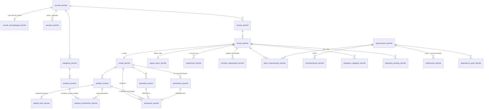

# Etapa 2: Modelagem de dados (Lanchei)

Arquivos em `database/`:
- `schema.sql`: script completo (MySQL 8.0+).
- `smoke_test.sql`: dados mínimos de exemplo.
- `testar_schema.sh`: recria o banco e confirma que 26 regras de integridade bloqueiam o que devem.
- `grants.sql` + `testar_grants.sh`: usuário da API com privilégios mínimos (produção) e o teste que confere essas permissões.

**Nomenclatura:** banco `lanchei`; toda tabela e view termina em `_lanchei`; colunas sem sufixo.

## Diagrama (entidades principais)

Tabelas de apoio fora do diagrama: `sessoes_lanchei` (refresh tokens), `tokens_email_lanchei` (verificação/senha), `webhook_eventos_lanchei` (log bruto do Mercado Pago), `auditoria_lanchei` (tudo que precisa de rastro). Views: `vw_contas_divergentes_lanchei` e `vw_estoque_divergente_lanchei` (devem retornar zero linhas).

## Grupos de tabelas

| Grupo | Tabelas (sem o sufixo) | Papel |
|---|---|---|
| Tenant | `escolas`, `escola_mercadopago` | Configuração da escola (fuso, depósito mín./máx.) e conta MP da cantina via OAuth |
| Pessoas | `usuarios`, `responsaveis`, `sessoes`, `tokens_email`, `dispositivos_push` | Equipe por escola (papéis SUPERADMIN, ADMIN = cantina, ESCOLA = diretoria, OPERADOR); responsáveis globais |
| Escola | `turmas`, `alunos`, `fotos_alunos`, `aluno_responsaveis`, `convites_responsavel`, `consentimentos` | Cadastro, foto e vínculo por código |
| Carteirinha | `carteirinhas` | Token do QR (só o hash), status ATIVA/BLOQUEADA/REVOGADA |
| Catálogo e estoque | `categorias`, `produtos`, `estoque_movimentos` | Por escola; estoque opcional por produto |
| Regras | `regras_aluno`, `bloqueios_categoria`, `bloqueios_produto` | Definidas pelos responsáveis, auditadas |
| Dinheiro | `contas`, `pedidos`, `pedido_itens`, `depositos`, `reembolsos`, `transacoes` | Ledger e operações |
| Infra | `webhook_eventos`, `notificacoes`, `auditoria` | Integração, push e rastreabilidade |

## Decisões de modelagem (e por quê)

1. **FKs compostas `(id, escola_id)`.** O banco recusa sozinho dados de uma escola apontando para outra (ex.: aluno da escola A numa turma da B), sem depender de a API acertar todo `WHERE`.
2. **Saldo materializado com proteção dupla.** `contas_lanchei.saldo_centavos` tem `CHECK >= 0`; cada linha do ledger guarda `saldo_apos_centavos` (também `>= 0`). A view de reconciliação compara o saldo com `SUM(ledger)`.
3. **Ledger "à prova de bug".** `CHECK`s exigem o sinal e a referência certos por tipo; `UNIQUE (pedido_id, tipo)` e `(deposito_id, tipo)` impedem lançamento duplicado, mesmo com webhooks em paralelo.
4. **Imutabilidade por trigger.** `transacoes`, `estoque_movimentos`, `auditoria`, `consentimentos` e `pedido_itens` recusam UPDATE e DELETE. Corrigir = lançar ESTORNO ou AJUSTE.
5. **Idempotência do caixa.** `UNIQUE (escola_id, idempotency_key)` em `pedidos_lanchei`.
6. **Uma carteirinha viva por aluno**, via coluna gerada `aluno_vivo` + `UNIQUE`, porque o MySQL não tem índice único parcial.
7. **Limite calculado pelos pedidos CONFIRMADOS do período.** Um estorno devolve o limite do período da compra original.
8. **Dias permitidos em bitmask** (`31` = seg–sex).
9. **Snapshot no item do pedido** (nome, categoria, preço).
10. **Recusas são gravadas** com `motivo_recusa`, para o push de "compra recusada" e o suporte.
11. **Datas em UTC; "hoje" e "esta semana" no fuso da escola** (calculados na API).
12. **Mercado Pago multi-tenant via OAuth**, com tokens da cantina criptografados.
13. **LGPD no schema:** aluno sem CPF, nascimento ou endereço; foto guardada no próprio banco (`fotos_alunos_lanchei`, JPEG 400×400 sem EXIF, ~30–60 KB), que só sai pela API autenticada e com auditoria; `anonimizado_em`; consentimento versionado e imutável.
14. **Venda manual (contingência):** `modo_identificacao = 'MANUAL'`, com `observacao` e `ocorrido_em` obrigatórios.
15. **Única exceção ao "nada se apaga":** bloqueios de categoria/produto são configuração; desbloquear apaga a linha, e o histórico fica em `auditoria_lanchei`.

## Estoque

- Opcional por produto (`controla_estoque`). Produtos sem controle (ex.: lanche feito na hora) não geram movimentos.
- `estoque_atual` é cache de `estoque_movimentos_lanchei`, no mesmo padrão do saldo: lock da linha do produto na venda, `CHECK >= 0`, view de reconciliação.
- Movimentos: ENTRADA, VENDA (automática no pedido), ESTORNO (devolução **opcional** no estorno, porque lanche comido não volta), PERDA, AJUSTE (inventário, exige motivo).
- **Falta de estoque não gera pedido recusado nem push para os pais.** A API devolve erro só para a tela do caixa.
- `estoque_minimo` gera alerta de "acabando" no painel.

## Regras de exibição que afetam a API (definidas nesta etapa)

- **A atendente não vê o saldo do aluno.** A tela do caixa mostra só nome, foto e turma, e o resultado (aprovado ou motivo da recusa). Para "saldo insuficiente", ela vê apenas esse motivo.
- **Sem restrição de horário**, só dias da semana.

## Limitação conhecida

**Pix devolvido depois de creditado** (contestação/MED): o depósito vira `DEVOLVIDO`, mas o saldo pode já ter sido gasto. O MVP alerta o admin, que lança um AJUSTE se houver saldo. O saldo nunca fica negativo.
